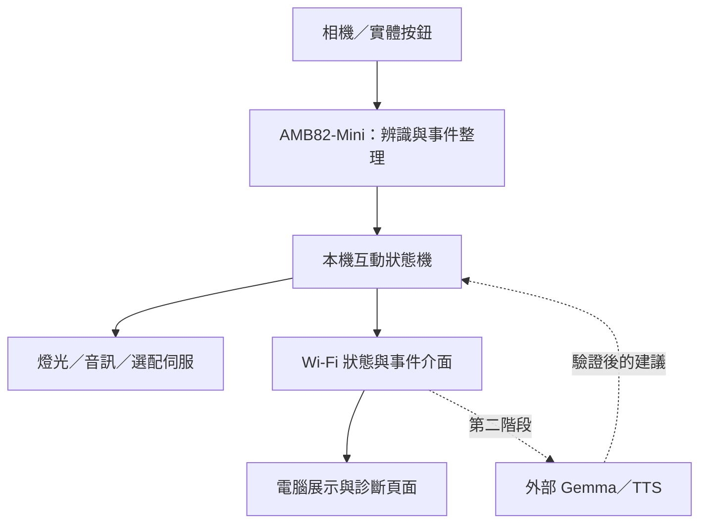

# 洛托姆的人類研究所

## 基於 AMB82-Mini 的視覺互動研究箱專題提案

版本：概念提案 v0.2｜日期：2026-11-01

> 本文件描述預計開發的原型，尚未完成硬體整合或性能驗證。洛托姆暫作主角，角色外觀與名稱可替換。

## AI 成品與架構示意


此圖為外觀概念，不是實拍成品。第一版使用外接電腦顯示文字與表情，箱內顯示配置需另行選型。


架構圖為設計規劃，非接線圖；橘色標示外部 AI 選配擴充。

## 1. 核心概念

觀眾以為自己將觀察箱中的寶可夢，靠近後才發現：箱內研究員正在觀察人類。裝置透過手勢任務、燈光、聲音及表情，讓觀眾成為「人類研究樣本」，最後產生趣味觀察報告。

洛托姆附身於研究設備的設定，適合以螢幕、發光邊框及少量機構表現角色。使用者不必先安裝 App 即可參與；開發者另用展示與診斷頁面檢查狀態。

## 2. 專題目標

1. 由 AMB82-Mini 執行本機影像辨識、互動流程與輸出控制。
2. 完成一次約 60–90 秒、單人參與的互動體驗；時間為設計目標。
3. 依成功、等待、重試、離開等事件產生不同回應。
4. 記錄任務結果與反應時間，形成可評估的成果。
5. 保留手機端 AI 擴充介面，第一版不依賴大型語言模型。

## 3. 互動劇情

| 階段 | 觸發條件 | 裝置表現 |
| --- | --- | --- |
| 待機 | 無人參與 | 暗色眼睛、呼吸燈；提示「寶可夢觀察體驗」 |
| 樣本發現 | 指定區域內穩定偵測到人 | 亮起表情，播放歡迎台詞 |
| 反轉揭露 | 完成開場 | 「今天的人類研究樣本自己走過來了！」 |
| 溝通測試 | 觀眾伸出手掌 | 確認手掌持續出現後，給予成功回應 |
| 模仿測試 | 手掌依提示移至畫面左、右區域 | 依序完成兩個位置任務 |
| 耐心測試 | 掃描動畫期間仍留在互動區 | 倒數結束後產生戲劇化評論 |
| 觀察報告 | 任務結束或跳過 | 顯示完成項目與趣味評語 |
| 重置 | 報告顯示結束、按鍵重置或長時間無人 | 清除本次狀態，返回待機 |

### 範例台詞

- 溝通成功：「已建立初步溝通。牠以為自己正在控制我們。」
- 模仿成功：「學習速度不錯，可以繼續訓練！」
- 未完成：「樣本正在質疑研究流程。這也是重要的研究資料。」
- 耐心成功：「樣本仍未離開，可能對本研究抱有不合理期待。」

台詞應保持幽默友善。觀察報告是遊戲回饋，不推論真實人格、情緒或健康狀況。

## 4. 第一版範圍與架構

### AMB82-Mini：必要核心

- 相機輸入與分階段辨識。
- 人員存在／手掌位置事件整理。
- 互動狀態機、計時與分支判斷。
- SD 卡預錄 MP3 播放控制。
- 外接燈光與選配伺服馬達控制。
- 經 Wi-Fi 提供狀態、事件與展示頁面所需資料。

### 電腦展示端：第一版輔助介面

- 顯示角色表情、任務文字、倒數與報告。
- 顯示診斷資料，提供開始、略過與重置操作。
- 不承擔第一版核心辨識與任務判斷。

### 手機／電腦 AI：第二階段選配

- 接收已確認的任務事件，生成變化台詞或報告。
- Gemma 4 E2B 在相容的外部裝置執行，不部署於 AMB82-Mini。
- 生成語音須另接 TTS；模型輸出經白名單驗證後才能觸發動作。
- AI Edge Gallery／Skills 的具體連接方式需另做版本與整合驗證。



## 5. 辨識與判斷策略

採固定相機、單一參與者、明確站位與手部操作區。人員偵測與手勢辨識依互動階段切換，先驗證模型切換的時間與穩定性，不預設多模型可同時順暢執行。

- 人員進場：指定區域內的人員偵測需連續成立，避免路過觸發。
- 手掌測試：使用手掌／手部模型輸出，經持續時間判斷才確認成功。
- 左右測試：以畫面座標的區域定義判斷；畫面鏡像與指示方向必須一致。
- 耐心測試：只確認指定期間內是否持續偵測到人，不追蹤或驗證個人身分。
- 超時與離開：給一次提示，再提供略過或重置。
- 閾值、確認時間、超時與冷卻時間集中設定，以現場測試校正。

若人員／手部模型切換尚未穩定，早期整合版可使用按鍵啟動，先完成手部互動，再補自動進場偵測。

## 6. 硬體需求

| 零件 | 用途 | 第一版需求 |
| --- | --- | --- |
| AMB82-Mini 開發板與相機、麥克風 | 辨識與控制；依實際套件確認附件 | 必要 |
| microSD 卡 | 預錄音訊、選配事件紀錄 | 必要 |
| 相容音訊輸出、擴大器與喇叭 | 播放角色台詞；例如評估 PAM8403 | 必要，需確認接線與訊號規格 |
| RGB 燈或燈條與適當驅動 | 眼睛、邊框與狀態提示 | 必要 |
| 按鈕 | 開始、重置與測試 | 必要 |
| 電腦與螢幕 | 表情、文字與報告展示 | 第一版必要 |
| 電源與配電 | 開發板、音訊及外接負載供電 | 必要，依負載選型 |
| 伺服馬達與支架 | 選配手臂、點頭或箱體小動作 | 後續加入 |
| IR 距離感測器 | 選配靠近喚醒 | 非必要，屬外接零件 |
| 箱體與攝影機固定架 | 固定視角、遮蔽線路、塑造角色 | 必要 |

馬達與大電流負載不得由 GPIO 直接供電；應依零件規格設計供電、驅動與共地。箱體先用紙板或簡單板材試作，確認攝影角度後再製作正式外觀。

## 7. 軟體模組與通訊草案

建議模組：Perception、InteractionStateMachine、AudioPlayer、ExpressionController、EventLog、NetworkInterface。名稱為設計草案，尚無對應實作。

| 介面 | 用途 |
| --- | --- |
| `GET /api/status` | 讀取目前階段、連線與播放狀態 |
| `GET /api/session` | 讀取本次任務結果 |
| `POST /api/session/start` | 開始體驗 |
| `POST /api/session/reset` | 中止並重置 |
| `POST /api/action` | 執行白名單燈光、音效或動作 |
| `WS /events` | 後續推送任務與辨識事件；早期可先輪詢 |

動作介面不接受任意 GPIO、PWM 或音訊路徑。需加入配對／存取憑證、參數驗證、命令有效時間及序號，避免未授權控制或重複動作。採瀏覽器展示時，另驗證跨來源、HTTP／WebSocket 及本地網路存取限制。

事件例：

```json
{
  "event": "task_completed",
  "session_id": "H-025",
  "task": "palm_test",
  "elapsed_ms": 2400,
  "attempts": 1
}
```

## 8. 觀察報告

第一版使用模板組合，欄位包含匿名場次編號、各任務結果、反應時間與嘗試次數。範例：

> 人類樣本 H-025：完成 3／3 項測試。看到閃光會主動靠近。洛托姆評語：值得繼續觀察的訓練家！

固定模板可在離線時運作；後續 AI 改寫必須依實際事件，不可捏造完成結果。

## 9. 實作里程碑

以下為順序建議，工期須依人數與期限另訂。

1. 開發板上線：相機、人員與手勢官方範例分別跑通。
2. 驗證關鍵風險：鏡頭位置、手部區域判斷、辨識任務切換。
3. 單一互動：按鍵開始、伸掌成功、燈光及台詞回應。
4. 完整流程：三項測試、超時分支、離開重置、模板報告。
5. 展示整合：電腦畫面、箱體、音訊與診斷介面。
6. 測試調整：光線、距離、不同參與者、連續運行與斷線。
7. 選配擴充：伺服動作、外部 AI 台詞、TTS。

## 10. 驗證方式與風險

| 項目 | 驗證方式 |
| --- | --- |
| 任務成功率 | 在固定光線與距離條件下，記錄多次正確完成與失敗 |
| 誤觸發率 | 測試路過、無人及非指定動作 |
| 回應延遲 | 量測事件成立至燈光／音效開始的時間 |
| 流程穩定性 | 連續執行、提前離開、超時、重置與展示端斷線 |
| 使用體驗 | 確認初次觀眾能否理解指令及「被觀察」的反轉 |

目標值須在原型基線測試後確定，本文不宣稱已達成辨識率或延遲數據。主要風險為箱體遮擋、光線變化、模型切換、音訊播放阻塞與外接負載造成供電不穩。

第一版不保存原始影像或錄音，僅記錄匿名事件；提供相機工作指示與實體電源開關。若加入機構，於韌體限制動作範圍與時間，並遮蔽夾點。

## 11. 預期成果

- 一套可展示的洛托姆主題互動研究箱。
- AMB82-Mini 韌體、展示頁面與通訊規格。
- 三項互動測試及至少成功、超時、離開分支。
- 匿名觀察報告、測試紀錄與展示影片。

## 12. 參考資料

本文依參考專案「嵌入式控制器＋外部高階 AI」的分工思路另行設計，未複製或驗證其韌體。參考專案亦指出硬體適配函式需依實際板包與周邊完成。

- [參考 PROPOSAL.md](https://github.com/rkuo2000/AI-plush-giraffe/blob/main/PROPOSAL.md)
- [參考 README.md](https://github.com/rkuo2000/AI-plush-giraffe/blob/main/README.md)
- [AMB82-Mini 官方手勢偵測文件](https://ameba-doc-arduino-sdk.readthedocs-hosted.com/en/latest/ameba_pro2/amb82-mini/Example_Guides/Neural%20Network/Hand%20Gesture%20Detection.html)
- [AMB82-Mini 官方文件](https://ameba-doc-arduino-sdk.readthedocs-hosted.com/en/latest/ameba_pro2/amb82-mini/index.html)
- [Google AI Edge Gallery](https://github.com/google-ai-edge/gallery)

寶可夢與洛托姆為既有角色；本提案為非官方原型構想，不代表官方合作。正式公開使用的角色素材與音訊來源需另行確定。
