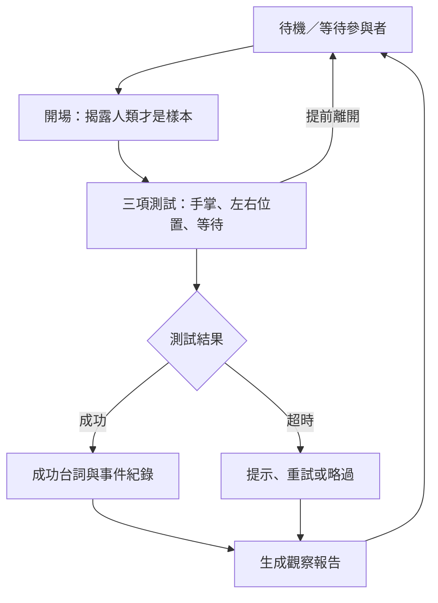

# 洛托姆的人類研究所

**今天換寶可夢研究你！**

以 AMB82-Mini 為核心的視覺互動研究箱。觀眾靠近箱體、完成手掌與位置任務，箱內的洛托姆便透過表情、燈光及預錄台詞，記錄這位「人類樣本」的反應，最後產生趣味觀察報告。

> 專案狀態：設計提案。已提供提案、README、AI 成品概念圖與系統架構圖；韌體、接線與展示頁面仍待實作。主角暫定洛托姆。

## AI 合成成品示意

**此圖為 AI 合成的外觀提案，並非已完成原型的實拍。**箱體正面配置相機、任務顯示區、燈光、開始按鈕及喇叭；旁邊的電腦顯示互動任務與報告。圖中為不含寶可夢角色素材的硬體外觀構想，洛托姆角色表情留待後續另行製作；整合顯示與造型為外觀構想，第一版實際表情／文字以外接電腦螢幕呈現；若使用箱內螢幕，需另行選型與整合。

## 系統架構圖

架構圖依規劃流程繪製，第一版包含本機辨識、事件判斷、實體輸出與電腦展示；橘色部分是後續外部 AI 整合。這是功能架構圖，不是腳位接線圖。

## 互動流程圖

各任務分別判斷成功與超時，最後彙整結果；流程圖省略各任務內部重試細節。

## 體驗流程

1. 靠近研究箱，喚醒洛托姆。
2. 伸出手掌，完成溝通測試。
3. 將手移到畫面指定區域，完成模仿測試。
4. 留在互動區等待掃描，完成耐心測試。
5. 查看本次「訓練家觀察報告」。

範例台詞：「已建立初步溝通。牠以為自己正在控制我們。」

每項任務都有成功與超時回應；提前離開可結束場次。報告根據任務紀錄產生，不是真實人格分析。

## 核心功能規劃

| 功能 | 第一版 | 後續擴充 |
| --- | --- | --- |
| 本機人員與手部偵測 | 分階段實作與驗證 | 更自然的互動 |
| 三項測試與狀態機 | 必要 | 更多劇情分支 |
| SD 卡預錄台詞 | 必要 | TTS 動態語音 |
| 燈光與螢幕表情 | 必要 | 伺服手臂動作 |
| 觀察報告 | 固定模板 | 外部 AI 改寫 |
| 自由語音對話 | 不列入第一版 | 手機端音訊與模型整合 |

## 系統分工

| 元件 | 工作 |
| --- | --- |
| AMB82-Mini | 影像辨識、事件整理、任務判斷、計時、音訊與輸出控制 |
| 電腦展示頁面 | 顯示表情、任務、倒數、報告及診斷資訊 |
| 選配手機／電腦 AI | 使用 Gemma 4 E2B 生成台詞或報告；另接 TTS |

AMB82-Mini 是主要控制與辨識核心。第一版在本地網路使用電腦螢幕展示，不要求手機 App、雲端服務或大型語言模型。若未來改成獨立螢幕，須另行評估介面、接線與驅動。

## 硬體準備

- AMB82-Mini 開發板，確認相機與麥克風配置。
- microSD 卡。
- 相容音訊輸出、擴大器與喇叭。
- RGB 燈光、必要的驅動電路及重置／開始按鈕。
- 合適電源、配線、固定相機的研究箱。
- 電腦、螢幕與本地 Wi-Fi 網路。
- 選配伺服馬達、支架與獨立負載供電。

IR、IMU、伺服與馬達驅動器均應按需求選配，不視為開發板已內建零件。

## 軟體準備

- Arduino IDE 與相容的 Ameba Pro2 板卡套件。
- 官方人員／物件偵測與手勢偵測範例。
- 展示頁面開發環境與瀏覽器。
- 自備或合法取得的角色圖像、MP3 台詞與音效。

實際板包版本、模型版本、腳位與音訊接線尚待確認；整合完成後應固定版本並補上重現步驟。

## 建議開發順序

1. 分別執行官方相機、物件偵測與手勢範例。
2. 固定鏡頭，測試指定站位與手掌左右區域。
3. 完成按鍵啟動的一項測試，接上燈光與單句音效。
4. 串接三項任務、超時與重置流程。
5. 製作展示頁面，接收本機狀態與場次結果。
6. 驗證自動進場、辨識模型切換與連續運作。
7. 完成箱體後重測光線、收音與供電，再加入選配動作。

以上為開發計畫，不是現有程式的安裝指令。

## API 草案

| 方法 | 路徑 | 用途 |
| --- | --- | --- |
| GET | `/api/status` | 讀取系統與目前階段 |
| GET | `/api/session` | 讀取本次任務結果 |
| POST | `/api/session/start` | 開始體驗 |
| POST | `/api/session/reset` | 中止並重置 |
| POST | `/api/action` | 白名單表情、音效與動作 |
| WebSocket | `/events` | 選配事件推送 |

介面尚未實作。需驗證瀏覽器本地網路存取與跨來源限制，並加入存取憑證、參數檢查及命令有效時間。不向外部 AI 開放任意 GPIO／PWM 寫入。

## 檔案規劃

| 路徑 | 用途 | 狀態 |
| --- | --- | --- |
| `PROPOSAL.md` | 專題目標、互動、架構與驗證計畫 | 本次提供 |
| `README.md` | 專案介紹與實作導覽 | 本次提供 |
| `firmware/` | AMB82-Mini 韌體 | 待建立 |
| `web/` | 展示與診斷頁面 | 待建立 |
| `assets/product-concept.png` | AI 合成外觀概念 | 本次提供 |
| `assets/system-architecture.png` | 系統架構圖 | 本次提供 |
| `assets/IMAGE_PROMPT.md` | 圖像生成說明與提示詞 | 本次提供 |
| `assets/` 其餘素材 | 台詞、音效與最終角色素材 | 待建立 |
| `docs/` | 接線、模型／板包版本及測試結果 | 待建立 |

## 展示與驗證

固定光線與距離下量測任務成功率、誤觸發、反應延遲及連續執行穩定性。另測提前離開、多人入鏡、超時與展示端斷線；未完成測試前不宣稱特定準確率。

預設僅保留匿名事件，不儲存影像或錄音。相機應有工作提示；選配機構須在韌體限制範圍與時間，並遮蔽夾點。

## 參考

- [完整專題提案](PROPOSAL.md)
- [AI-plush-giraffe：PROPOSAL.md](https://github.com/rkuo2000/AI-plush-giraffe/blob/main/PROPOSAL.md)
- [AI-plush-giraffe：README.md](https://github.com/rkuo2000/AI-plush-giraffe/blob/main/README.md)
- [AMB82-Mini 官方文件](https://ameba-doc-arduino-sdk.readthedocs-hosted.com/en/latest/ameba_pro2/amb82-mini/index.html)
- [Google AI Edge Gallery](https://github.com/google-ai-edge/gallery)

本專案為非官方寶可夢主題原型構想。素材來源與使用方式待確定；已附 AI 合成外觀示意與架構圖，未附官方音訊或可執行程式。

## GitHub 作業提交方式

1. 開啟老師的 [AI-plush-giraffe 範例](https://github.com/rkuo2000/AI-plush-giraffe)，使用 Fork 建立自己的儲存庫。建議名稱：`Rotom-Human-Lab`。
2. 將本專案的 `PROPOSAL.md` 與 `README.md` 放在儲存庫根目錄，替換範例的同名文件。
3. 將整個 `assets` 資料夾一併上傳。不要只上傳 Markdown，否則圖片無法顯示。
4. 若 Fork 內仍有老師範例的長頸鹿圖片、程式與說明，將其清楚標示為上游參考，避免誤認為本專案已實作的功能。
5. 開啟 GitHub 首頁，確認成品圖、架構圖與提案連結均正常顯示，再提交自己的儲存庫網址。

Fork 與上傳尚需在你的 GitHub 帳號執行，本文件不表示已完成遠端建立。
